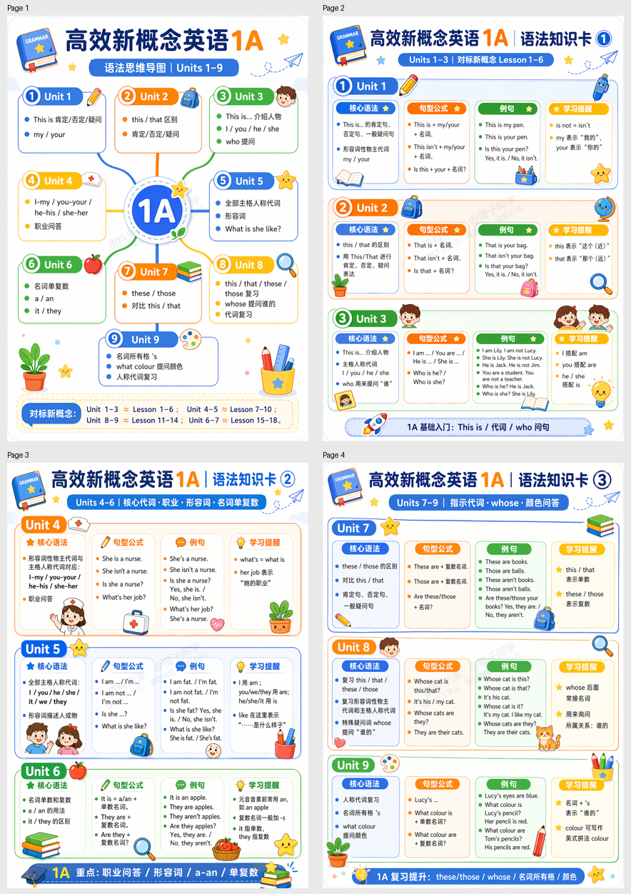

# pdf-watermark-tool

English | [中文](README.zh-CN.md)

[](LICENSE)
[](#)
[](https://www.python.org/)

> Batch-add a subtle, centered, diagonal text watermark to every page of your PDFs — locally, in one click.

A lightweight, offline PDF watermark tool. It stamps a two-line semi-transparent diagonal text watermark in the middle of every page, flattens it into the page image so it can't be removed as a separate object, and saves results to a new folder — your originals are never touched.



## ✨ Features

- 🖱️ **One-click GUI** — double-click `双击运行.bat` (Windows) or run the script, pick your PDFs or a whole folder, done. No account, no cloud, no watermark SaaS.
- 🎛️ **Fully configurable via JSON** — two lines of text, opacity, tilt angle, color, DPI, custom font. No code changes needed.
- 🖼️ **Smart rasterization** — pure image pages keep their original pixels (no quality loss); vector / text-heavy pages are rendered at your chosen DPI. Bookmarks and metadata are preserved.
- 🛡️ **Safe by design** — refuses to overwrite existing files, skips encrypted PDFs with a clear error, logs a `处理记录.json` report per batch so one bad file never aborts the whole run.
- 📦 **Batch processing** — multi-select PDFs or point it at a folder; every output goes into a timestamped subfolder so you can run it repeatedly without collisions.

Works on Windows, macOS, and Linux. Uses only PyMuPDF + Pillow.

## When would you use this?

- **Course creators / knowledge-card sellers** — stamp "© Your Name — for personal use only" on PDFs before sending to buyers, to deter reposting.
- **Teachers / tutors** — watermark handouts shared on social media with your WeChat / Xiaohongshu handle.
- **Teams sharing internal docs** — tag confidential PDFs with an internal-project line before circulating.
- **Anyone who hates Canva / iLovePDF watermark quotas** — runs locally, unlimited pages, no per-file fee.

## Quick start

### Windows

1. Make sure Python 3.10+ is installed (from [python.org](https://www.python.org/downloads/windows/), tick "Add to PATH").
2. Double-click `双击运行.bat`. First run auto-installs dependencies (PyMuPDF, Pillow) — needs internet once.
3. Pick your PDFs (Ctrl-click for multi-select) or a whole folder.
4. Find results in a new `已加水印_YYYYMMDD_HHMMSS/` folder next to your source PDFs.

### macOS / Linux

```bash
pip install -r requirements.txt
python pdf_watermark.py                 # opens the file-picker dialog
python pdf_watermark.py a.pdf b.pdf     # process specific files
python pdf_watermark.py ./my-pdfs       # process a whole folder
```

## Configure your watermark

Edit `watermark_config.json` with any text editor:

| Field | Meaning | Default |
|---|---|---|
| `primary_line` | First watermark line (one line, no line breaks) | `Your Name @your-handle` |
| `secondary_line` | Second watermark line (one line) | `For personal use only. Do not redistribute.` |
| `opacity` | 0.01 – 1, higher = darker | `0.12` |
| `angle` | Tilt in degrees, −89 to 89 | `28` |
| `color` | Six-digit hex color | `#536D91` |
| `raster_dpi` | Render DPI for complex pages, 72–600 | `300` |
| `font_path` | Custom TTF/OTF path; leave empty to auto-detect system CJK font | `""` |

> Text must be a single line (no `\n`). Chinese, English, or mixed both work. Save and re-run.

## CLI options

```text
python pdf_watermark.py [INPUTS...] [--output DIR] [--config FILE]

INPUTS       one or more PDF files, or a folder (top-level only, no recursion)
--output    parent folder for the timestamped output dir (default: next to first input)
--config    path to a custom watermark JSON (default: ./watermark_config.json)
```

## Notes & limitations

- **Don't re-watermark already-watermarked PDFs** — the stamp will stack twice.
- **Encrypted PDFs** need to be decrypted to a copy first; the tool will skip them and log the error.
- **Large pages** (> ~60 megapixels at chosen DPI) are skipped with a message — lower `raster_dpi` to retry.
- **Vector pages become images**: for pages that originally contained selectable text, after stamping they are flattened to images, so text search / copy / form fields / hyperlinks on those pages are no longer interactive. Bookmarks (outline TOC) are preserved.
- This is not a DRM tool. A determined user can still erase the watermark with image editing.

## Test

```bash
python -m pytest tests
```

## Keywords

pdf watermark, batch watermark, stamp pdf, diagonal watermark, anti-piracy pdf, course material watermark, pdf protection, watermark cli, pymupdf, fpdf, reportlab, 批量加水印, PDF水印, 防搬运, 知识图卡, 版权水印

## License

[MIT](LICENSE)
