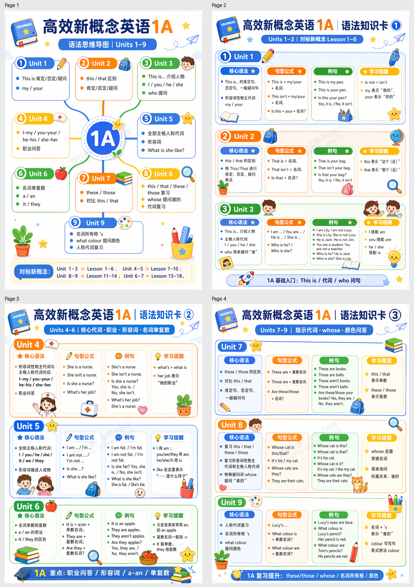

# pdf-watermark-tool

[English](README.md) | 中文

[](LICENSE)
[](#)
[](https://www.python.org/)

> 给一堆 PDF 批量打上居中斜向浅色文字水印，本地一键完成。

一个轻量、完全离线的 PDF 水印工具：在每一页正中央盖两行半透明倾斜文字水印，水印直接合入页面像素，无法作为独立对象被删除；结果另存到新文件夹，原文件原封不动。



## ✨ 核心功能

- 🖱️ **双击即用的图形界面** —— Windows 上双击 `双击运行.bat`，选 PDF 或整个文件夹就开跑。不用注册、不用上传、不用看在线工具的水印额度。
- 🎛️ **JSON 配置，无需改代码** —— 两行水印文字、不透明度、倾斜角度、颜色、渲染 DPI、自定义字体，全在 `watermark_config.json` 里改。
- 🖼️ **智能栅格化** —— 纯图片页直接保留原图像素（不糊不重压缩）；矢量/文字页按指定 DPI 渲染后叠水印，书签和元数据自动保留。
- 🛡️ **安全设计** —— 拒绝覆盖已有文件；带打开密码的 PDF 自动跳过并记录原因；每批生成 `处理记录.json`，单个文件失败不会拖垮整批。
- 📦 **批量处理** —— 支持多选 PDF 或整个文件夹，每次输出到带时间戳的独立文件夹，反复跑不冲突。

跨 Windows / macOS / Linux，只依赖 PyMuPDF + Pillow。

## 适用场景

- **课程/知识图卡卖家** —— 发资料前盖上"© 你的署名 · 仅供个人学习"，防搬运、防二转卖。
- **老师 / 培训机构** —— 给发到社交媒体的讲义加上你的微信 / 小红书账号水印。
- **团队内部资料流转** —— 内部 PDF 加盖项目名水印再外传。
- **受够了在线工具按页收费** —— 本地跑，页数不限，不花一分钱。

## 快速开始

### Windows

1. 装 Python 3.10+（从 [python.org](https://www.python.org/downloads/windows/) 下载，安装时勾选 "Add to PATH"）。
2. 双击 `双击运行.bat`。首次运行会自动装依赖（PyMuPDF、Pillow），需要联网一次。
3. 选 PDF（Ctrl 多选）或整个文件夹。
4. 结果出现在原 PDF 旁边的 `已加水印_YYYYMMDD_HHMMSS/` 文件夹里。

### macOS / Linux

```bash
pip install -r requirements.txt
python pdf_watermark.py                 # 弹出文件选择窗口
python pdf_watermark.py a.pdf b.pdf     # 直接处理指定文件
python pdf_watermark.py ./my-pdfs       # 处理整个文件夹
```

## 配置水印

用记事本 / VS Code 打开 `watermark_config.json` 修改：

| 字段 | 说明 | 默认值 |
|---|---|---|
| `primary_line` | 水印第一行（单行，不能换行） | `Your Name @your-handle` |
| `secondary_line` | 水印第二行（单行） | `For personal use only. Do not redistribute.` |
| `opacity` | 不透明度 0.01–1，越大越深 | `0.12` |
| `angle` | 倾斜角度 −89 到 89 度 | `28` |
| `color` | 六位十六进制颜色 | `#536D91` |
| `raster_dpi` | 复杂页渲染 DPI，72–600 | `300` |
| `font_path` | 自定义字体路径，留空自动用系统中文字体 | `""` |

> 文字只能一行，不能有换行。中英文都支持，保存后重新运行即可。

## 命令行参数

```text
python pdf_watermark.py [INPUTS...] [--output DIR] [--config FILE]

INPUTS    一个或多个 PDF 文件，或文件夹（只处理当前层，不递归子目录）
--output  结果文件夹的上级目录（默认：第一个输入 PDF 旁边）
--config  指定自定义配置 JSON（默认：./watermark_config.json）
```

## 注意事项

- **不要重复加水印** —— 已经加过水印的 PDF 再丢进去会叠两层。
- **加密 PDF** —— 需要先另存为无密码副本，工具会自动跳过并在日志里记录原因。
- **超大页** —— 单页超过约 6000 万像素会跳过该文件，调低 `raster_dpi` 重试。
- **矢量页会被栅格化** —— 原本能选中、能复制的文字页，加完水印后变成图片，文字搜索/复制/表单/超链接在这些页上不再可用；书签（目录）会保留。
- 这不是 DRM 工具，决心要去除水印的人依然可以用修图软件抹掉。

## 测试

```bash
python -m pytest tests
```

## 关键词（方便搜索）

PDF 加水印、批量水印、斜向水印、防搬运、课程资料版权、知识图卡、pdf watermark、batch stamp、anti-piracy、pymupdf、水印 CLI

## 开源协议

[MIT](LICENSE)
